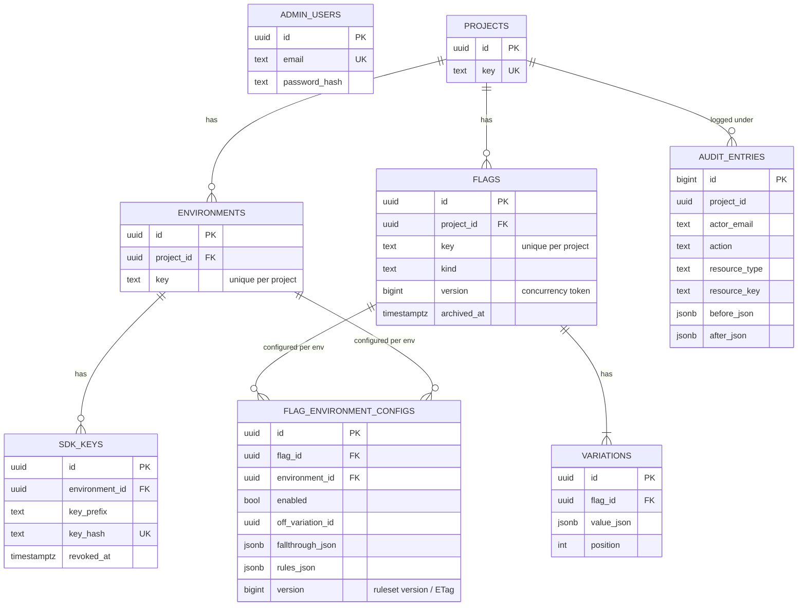

# Data model

Tables created in Phase 1 are in the first migration. Tables marked *later* arrive as new
migrations when their phase starts (one migration per feature is a good habit to show in git history).

## Added in later phases

| Table | Phase | Purpose |
| --- | --- | --- |
| `segments` | 3 | Reusable groups of users referenced from rule clauses |
| `experiments` | 7 | Links a flag + environment + metric, with start/stop times |
| `events` | 7 | Exposure and conversion events sent by SDKs |

## Design notes

- **Targeting lives in jsonb** (`fallthrough_json`, `rules_json`) instead of many small tables. Rules are always read
  and written as a unit, never queried individually, so a document fits better than joins.
- **Rollout weights are basis points** (10000 = 100%) and bucketing will be `hash(flagKey + userKey) mod 10000`.
- **`version` columns** do two jobs: optimistic concurrency now, and the ruleset version/ETag that SDKs and Redis use in Phase 3-4.
- **SDK keys are stored as SHA-256 hashes.** The plaintext key is returned once at creation.
- **The audit log is append-only**: no update or delete endpoints exist. In production, also revoke UPDATE/DELETE on the table
  for the application's database role.
